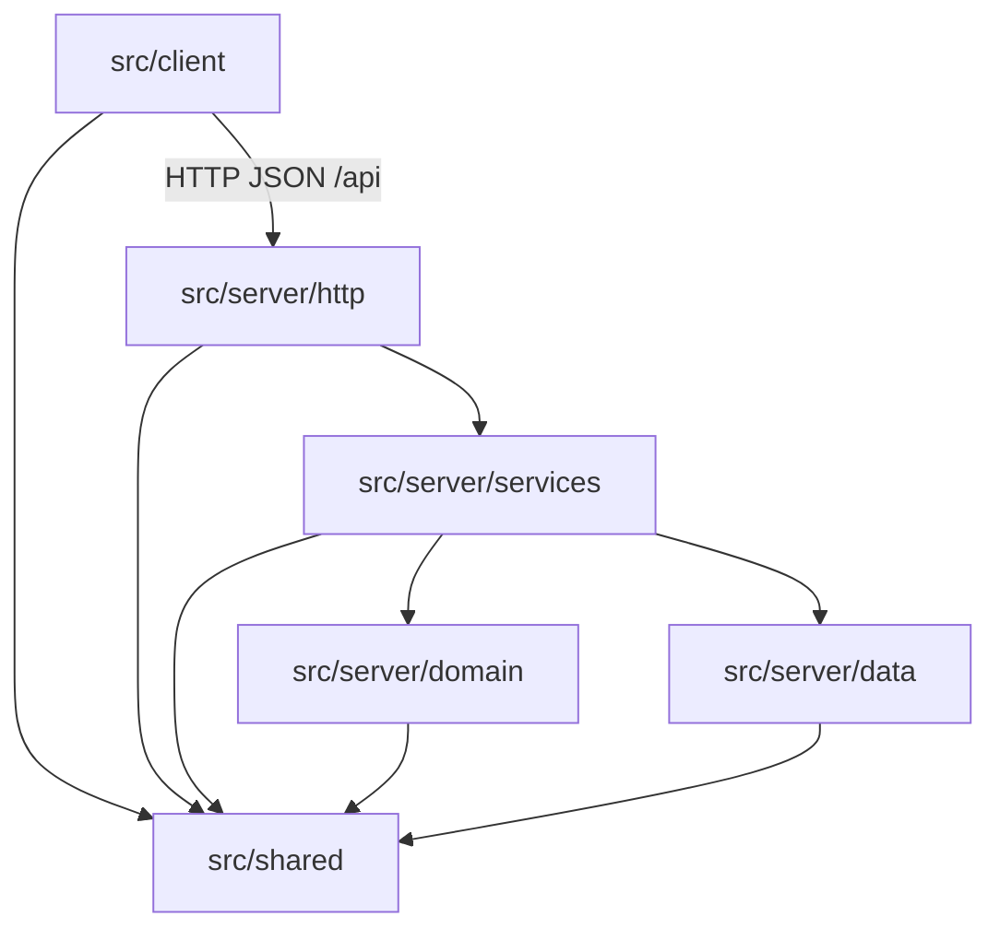
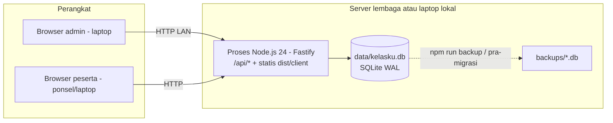
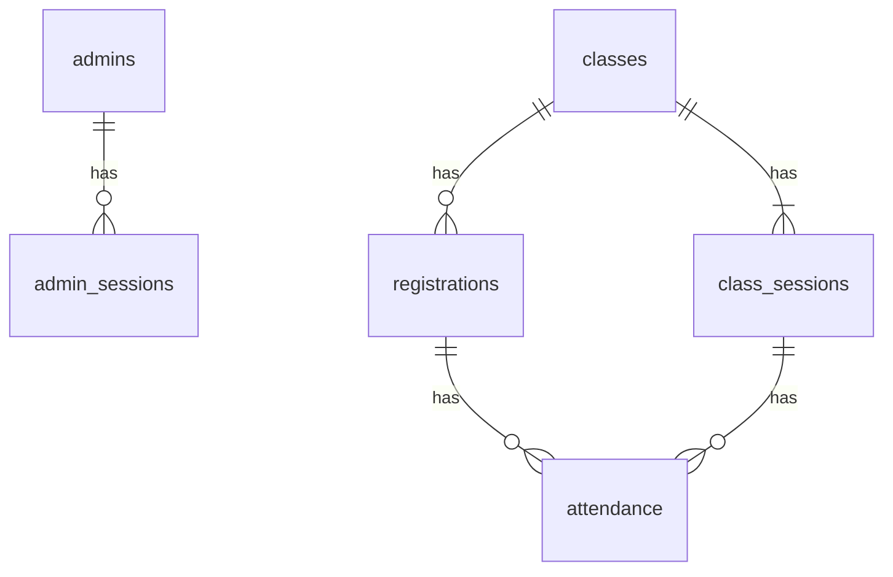

# Architecture Spine — Kelasku

## Design Paradigm

**Modular monolith berlapis, functional core / imperative shell.** Satu proses Node.js, satu package npm, satu berkas SQLite. Aturan bisnis R1–R7 hidup di inti domain yang murni (tanpa I/O, tanpa jam). Lapisan service mengorkestrasi use case dan memegang transaksi. Lapisan HTTP dan UI hanya menerjemahkan.

| Lapisan | Direktori | Isi | Boleh bergantung ke |
| --- | --- | --- | --- |
| shared | `src/shared/` | Skema zod, DTO, kode & pesan error, `normalizeEmail`, formatter tanggal WIB, label Glosarium | — |
| domain | `src/server/domain/` | Fungsi murni: status kelas, posisi antrean, keputusan Terdaftar/Daftar tunggu, jumlah promosi, kelayakan R6/FR-20, validasi tanggal sesi | shared |
| data | `src/server/data/` | Koneksi, `withWriteTx`, repository SQL bertipe, migrasi | shared |
| service | `src/server/services/` | **Use-case** (membuka transaksi) dan **tx-step** (menerima `Tx`, tidak pernah membuka transaksi) | domain, data, shared |
| http | `src/server/http/` | Route Fastify, parse zod, auth admin, pemetaan error ke HTTP, fallback SPA | service, shared |
| client | `src/client/` | SPA React: halaman, komponen, `api/` (fetch wrapper), `styles/tokens.css` | shared (ke server hanya lewat HTTP) |



Panah adalah satu-satunya arah yang diizinkan. `domain` tidak mengimpor `data`; `client` tidak mengimpor apa pun dari `src/server`; `shared` tidak mengimpor apa pun.

## Invariants & Rules

### AD-1 — Satu package, satu proses, satu berkas SQLite [ADOPTED]

- **Binds:** all; NFR-6
- **Prevents:** layanan terpisah, DB cloud, atau dua proses server yang menulis ke berkas yang sama sehingga jaminan transaksi pecah.
- **Rule:** Satu `package.json` di root (npm, satu `package-lock.json`). Produksi menjalankan satu proses Fastify yang melayani `/api/*` dan berkas statis hasil `vite build`. Proses itu membuka `DATABASE_PATH` (bawaan `./data/kelasku.db`) dengan `journal_mode=WAL`, `foreign_keys=ON`, `busy_timeout=5000`. Skrip CLI (`admin:create`, `backup`) boleh membuka koneksi sendiri dan menulis hanya lewat use-case yang sama; `seed:demo` hanya jalan saat server mati.

### AD-2 — Akses data lewat better-sqlite3 + SQL di repository, tanpa ORM

- **Binds:** semua kode di `src/server/data/`
- **Prevents:** campuran ORM, query builder, dan SQL mentah; transaksi async yang bisa diselingi request lain.
- **Rule:** Hanya `src/server/data/` yang mengimpor `better-sqlite3`. SQL ditulis di fungsi repository bertipe dengan parameter terikat (`?`/`@name`), tidak pernah interpolasi string. Service tidak menulis SQL.

### AD-3 — Setiap operasi tulis = satu transaksi `BEGIN IMMEDIATE` yang dibuka oleh use-case

- **Binds:** FR-2, FR-3, FR-7–FR-13, FR-15; R1, R2, R4, R7; NFR-1
- **Prevents:** cek-lalu-tulis di luar transaksi; dua pendaftaran bersamaan mengambil kursi terakhir; promosi ganda; transaksi bersarang.
- **Rule:** Hanya fungsi use-case di `src/server/services/` yang memanggil `withWriteTx(db, clock, (tx, ctx) => …)`, yang membungkus `db.transaction(fn).immediate()` dan melempar bila `db.inTransaction` sudah benar. Tx-step (`assertClassOpen`, `promoteFromWaitlist`, `cancelRegistration`, dll.) menerima `tx` dan `ctx`, tidak pernah membuka transaksi. Semua pembacaan yang mendasari keputusan — tanggal sesi dan status kelas, kuota, `COUNT(*)` Terdaftar, antrean, pendaftaran aktif — dilakukan di dalam `fn`. Tidak ada kolom counter. `fn` sinkron; tidak ada `await` di dalamnya. `SQLITE_BUSY` dipetakan ke HTTP 503 `database_busy`.

### AD-4 — Satu jalur promosi daftar tunggu

- **Binds:** FR-3, FR-11, FR-12, FR-13; R1, R3, R4, R7
- **Prevents:** pembatalan peserta, pembatalan admin, dan kenaikan kuota masing-masing memiliki logika promosi sendiri.
- **Rule:** Promosi hanya terjadi lewat tx-step `promoteFromWaitlist(tx, ctx, classId)`, dipanggil di dalam transaksi pemicunya, dan mengembalikan `promotedCount`. Ia memanggil `assertClassOpen` dulu (kelas Selesai tidak pernah mempromosikan). Jumlahnya `min(kuota − COUNT(Terdaftar), panjang antrean)`, diambil dari kepala antrean (urut `registrations.id` naik), dan setiap baris yang naik mendapat `promoted_at = ctx.nowIso`.

### AD-5 — Keputusan pendaftaran dan R2 dijaga dua lapis

- **Binds:** FR-7, FR-8, FR-9, FR-10; R1, R2, R3
- **Prevents:** pendaftar baru menyalip antrean; klik ganda menghasilkan dua baris; pelanggaran unique bocor sebagai HTTP 500.
- **Rule:** Di dalam transaksi, setelah `assertClassOpen`: cari pendaftaran aktif untuk `(class_id, normalizeEmail(email))`; bila ada, kembalikan status itu dengan `alreadyActive: true`. Bila tidak, status = Terdaftar hanya bila `COUNT(Terdaftar) < kuota` **dan** antrean kosong, selain itu Daftar tunggu. Skema memiliki unique index parsial `(class_id, email) WHERE status IN ('registered','waitlisted')`. Bila insert melempar `SQLITE_CONSTRAINT_UNIQUE`, use-case menangkapnya di luar transaksi, membaca ulang, dan mengembalikan bentuk `alreadyActive` yang sama. `normalizeEmail` (trim + lowercase) hanya ada di `src/shared/` dan dipakai sebelum setiap simpan dan cari.

### AD-6 — Nilai turunan dihitung saat baca oleh domain murni

- **Binds:** FR-4, FR-5, FR-10, FR-14, FR-17, FR-19, FR-20, FR-21, FR-22; R3, R6
- **Prevents:** status kelas, posisi antrean, atau kelayakan disimpan lalu basi; layar admin, status peserta, dan CSV menghitung dengan rumus berbeda.
- **Rule:** Status kelas (Dibuka/Penuh/Selesai; Selesai bila `max(session_date) < today`), posisi antrean (1-based, urut `id`), "sesi berikutnya", state per sesi, dan kelayakan dihitung oleh fungsi di `src/server/domain/` dan tidak pernah disimpan. Kelayakan memakai bilangan bulat saja: Layak bila `hadir * 5 >= totalSesi * 4`; Tidak mungkin layak bila `(hadir + sesiTanpaCatatan) * 5 < totalSesi * 4`. Pendaftaran Daftar tunggu di kelas Selesai tidak punya posisi (tampil "Kelas selesai — tidak naik dari daftar tunggu"). Grid rekap, halaman status, beranda, dan CSV memanggil fungsi yang sama.

### AD-7 — Waktu hanya dari `Clock`; "hari ini" = Asia/Jakarta; satu `ctx` per transaksi

- **Binds:** FR-2, FR-3, FR-7, FR-11, FR-15, FR-16, FR-17, FR-22; R5; NFR-2
- **Prevents:** satu modul memakai UTC, modul lain zona server; promosi dan pembatalan berbeda pendapat soal "Selesai" pukul 00.00–07.00 WIB; test R5 bergantung jam mesin.
- **Rule:** `Clock { now(): Date; todayJakarta(): string /* YYYY-MM-DD */ }` dibuat sekali di `src/server/clock.ts` (`Intl.DateTimeFormat`, `timeZone: 'Asia/Jakarta'`). `withWriteTx` membaca clock **setelah** `BEGIN IMMEDIATE` dan meneruskan `ctx = { nowIso, today }`; use-case baca membangun `ctx` yang sama sekali di awal. `new Date()`, `Date.now()`, dan `toISOString().slice(0,10)` untuk "hari ini" dilarang di `domain/` dan `services/`. Bila `NODE_ENV=test` dan `KELASKU_FAKE_NOW` diisi, `Clock` memakai nilai itu; di luar test variabel ini diabaikan. Klien tidak pernah menentukan "hari ini" untuk aturan; ia memakai `today` dari respons API (AD-20).

### AD-8 — Kontrak HTTP: tiga ruang rute, satu envelope error

- **Binds:** semua route `src/server/http/` dan `src/client/api/`
- **Prevents:** route admin yang lupa dicek auth; tiap endpoint memakai bentuk error berbeda; pesan Indonesia ditulis ulang di klien dan menyimpang.
- **Rule:** Route admin di `/api/admin/*` didaftarkan di dalam satu plugin Fastify yang memasang hook auth (401 tanpa sesi valid). Route publik di `/api/public/*`; auth di `/api/auth/{login,logout,session}`. Body JSON. Error selalu `{ "error": { "code": string, "message": string, "fields"?: Record<string,string> } }`; `code` snake_case Inggris yang stabil dan `message` Indonesianya didaftar di `src/shared/errors.ts`; kunci `fields` adalah path bertitik (`sessionDates.2`). Hasil bisnis yang sah (Daftar tunggu, sudah aktif, sudah dibatalkan, tidak ada pendaftaran aktif) adalah HTTP 200. Konfirmasi yang wajib dari server (AD-19) adalah 409 `confirmation_required`. Input divalidasi dengan skema zod dari `src/shared/schemas.ts` di server. `/api/*` yang tidak dikenal → 404 envelope; path lain → `index.html`. Fetch wrapper klien adalah satu-satunya pemanggil `fetch`: ia mengubah kegagalan jaringan dan respons tanpa envelope menjadi `network_error` / `unexpected_response` (pesan dari `errors.ts`), dan setiap 401 mengalihkan ke `/admin/masuk?next=<path same-origin>`.

### AD-9 — Sesi admin berbasis cookie dan tabel SQLite; akun dari skrip

- **Binds:** FR-1; NFR-8
- **Prevents:** campuran JWT dan sesi server; logout yang tidak mencabut akses; akun admin produksi bercampur data demo.
- **Rule:** Login memverifikasi password `scrypt` (`node:crypto`, salt per akun), membuat token acak 32 byte, dan menyimpan hash SHA-256-nya di `admin_sessions` dengan `expires_at = login + 12 jam`. Cookie `kelasku_session`: `HttpOnly`, `SameSite=Lax`, `Path=/`, `Secure` bila `COOKIE_SECURE=true`. Logout menghapus barisnya. `GET /api/auth/session` mengembalikan email admin atau 401. Endpoint tulis menolak `Content-Type` selain `application/json`. Akun admin hanya dibuat/diperbarui oleh `npm run admin:create` (idempoten, aman di produksi, mendukung banyak admin); tidak ada UI pendaftaran admin.

### AD-10 — Identitas dan format data

- **Binds:** skema DB, DTO, URL
- **Prevents:** ID berurutan bocor di tautan publik; tanggal sesi tergeser zona waktu; email yang sama tersimpan dalam dua bentuk.
- **Rule:** PK `INTEGER PRIMARY KEY AUTOINCREMENT`. Kode publik 10 karakter base64url dari `crypto.randomBytes`, `UNIQUE`, tidak pernah diubah: `classes.public_code` (tautan pendaftaran) dan `registrations.public_ref` (pembatalan publik). ID internal tidak muncul di URL publik. Tanggal sesi `TEXT 'YYYY-MM-DD'` (kalender WIB). Timestamp `TEXT` ISO-8601 UTC dengan milidetik (AD-15), diformat ke WIB hanya oleh `src/shared/format.ts`. Status pendaftaran disimpan sebagai `'registered' | 'waitlisted' | 'cancelled'`; label Indonesia hanya dari `src/shared/glossary.ts`. Email tidak pernah muncul di URL atau query string.

### AD-11 — Presensi melekat pada pendaftaran dan baris sesi; R5 ditegakkan di service

- **Binds:** FR-3, FR-15, FR-16, FR-18, FR-21, FR-22; R5, R6
- **Prevents:** presensi diwarisi pendaftaran baru; baris yatim membuat `hadir > totalSesi`; sesi mendatang diisi lewat API langsung; roster berubah diam-diam saat formulir terbuka.
- **Rule:** `attendance(registration_id FK, class_session_id FK ON DELETE RESTRICT, present INTEGER 0|1)` dengan `UNIQUE(registration_id, class_session_id)`. Use-case simpan presensi me-resolve `:date` ke `class_sessions` kelas itu di dalam transaksi (tanggal bukan sesi → 404 `session_not_found`), menolak bila `session_date > ctx.today` (`session_not_yet_open`), lalu meng-upsert seluruh baris dalam satu `withWriteTx`. Baris dengan `present: null` tidak ditulis. Bila ada baris untuk pendaftaran yang tidak lagi Terdaftar di kelas itu, seluruh batch ditolak (409 `roster_changed`). Ketiadaan baris = "Belum dicatat". Presensi tetap bisa dikoreksi di kelas Selesai. Baris presensi pendaftaran Dibatalkan tetap ada; tampilan, rekap, dan kelayakan hanya menyertakan pendaftaran Terdaftar.

### AD-12 — Skema hanya berubah lewat migrasi SQL bernomor

- **Binds:** `src/server/data/migrations/`; operasi upgrade
- **Prevents:** dua cerita mengubah skema dengan cara berbeda; DB lokal menyimpang; upgrade yang merusak data tanpa salinan.
- **Rule:** Berkas `NNN_description.sql` diterapkan berurutan saat server start, masing-masing dalam satu transaksi, dicatat lewat `PRAGMA user_version`, hanya maju. Sebelum menerapkan migrasi tertunda pada DB yang sudah berisi, server membuat salinan `backups/pre-migration-<user_version>-<timestamp>.db`; migrasi gagal = proses berhenti dengan exit code bukan nol. Berkas yang sudah di-merge ke `main` tidak diedit. Tidak ada `CREATE TABLE` di luar berkas migrasi.

### AD-13 — UI: satu sumber token, satu set komponen bersama, tanpa UI library

- **Binds:** semua `src/client/`; DESIGN.md, EXPERIENCE.md; NFR-3, NFR-4, NFR-5
- **Prevents:** dua sistem styling; warna hardcode yang melanggar kontras; label status atau format tanggal yang berbeda dari Glosarium; pola a11y dibuat ulang per halaman.
- **Rule:** Tidak ada UI library komponen atau framework CSS. Token DESIGN.md dipetakan 1:1 ke custom properties di `src/client/styles/tokens.css`; komponen hanya memakai `var(--…)`, tidak ada hex di luar berkas itu. Komponen bersama dibuat sekali di `src/client/components/` dan dipakai ulang: `PageLayout` (skip link, fokus ke `h1` saat pindah rute), `AdminLayout` (cek `GET /api/auth/session`), `Badge`, `ResultPanel`, `DataTable`, `ConfirmDialog`, `Toast` (live region), `Field`, `ErrorSummary`, `CopyLinkButton`. Semua label status dan format tanggal ("Senin, 9 Nov 2026", "9 Nov 2026, 14.32 WIB") berasal dari `src/shared/glossary.ts` dan `src/shared/format.ts` (`Intl`, `id-ID`, `Asia/Jakarta`). Router: React Router data mode (`createBrowserRouter`); perubahan belum tersimpan dijaga dengan `useBlocker` + `beforeunload`; data diambil lewat `src/client/api` tanpa loader/action.

### AD-14 — Strategi test per lapisan

- **Binds:** semua test; NFR-1, NFR-9
- **Prevents:** test aturan bisnis yang me-mock DB sehingga tidak membuktikan transaksi; test konkurensi yang lulus hanya karena serial di satu koneksi; e2e yang mengabaikan clock palsu.
- **Rule:** Vitest: `domain/` diuji sebagai fungsi murni; `services/` dan `data/` diuji terhadap berkas SQLite sementara yang nyata, satu DB per test file; HTTP diuji dengan `fastify.inject()`. Test konkurensi R1, R2, R4, R7 membuka minimal dua koneksi ke berkas yang sama dari `worker_threads` dan menjalankan operasi bersamaan. Setiap test aturan menyebut ID aturannya di nama `describe`/`it`. Playwright menjalankan build produksi dengan `NODE_ENV=test`, `KELASKU_FAKE_NOW`, dan DB baru dari `seed:demo` (yang mengambil "hari ini" dari `Clock`), serta pemeriksaan `@axe-core/playwright` di setiap permukaan IA EXPERIENCE.md.

### AD-15 — Timestamp hanya dari `ctx.nowIso`; FIFO = urutan `id`

- **Binds:** semua migrasi dan repository; R3, R4
- **Prevents:** satu migrasi memakai `DEFAULT CURRENT_TIMESTAMP` (`2026-11-02 09:00:00`) dan repository lain `toISOString()` sehingga `ORDER BY` waktu tidak lagi FIFO; clock palsu diabaikan oleh SQL; antrean terbalik saat dua request membaca jam sebelum mengunci.
- **Rule:** Tidak ada fungsi waktu SQL (`CURRENT_TIMESTAMP`, `datetime('now')`, `strftime('now')`) maupun `DEFAULT` waktu di skema. Setiap kolom `*_at` diisi dari `ctx.nowIso` dan diberi `CHECK (col GLOB '[0-9][0-9][0-9][0-9]-[0-9][0-9]-[0-9][0-9]T*Z')`. Urutan antrean dan promosi memakai `registrations.id` (dialokasikan di dalam write lock), bukan `created_at`.

### AD-16 — Satu jalur pembatalan, idempoten, berdasarkan identitas pendaftaran

- **Binds:** FR-11, FR-12, FR-13; R4
- **Prevents:** retry tertunda membatalkan pendaftaran ulang yang lebih baru; pembatalan admin dan peserta berperilaku beda; pembatalan kedua menimpa waktu/pembatal atau memicu promosi kedua.
- **Rule:** Kedua rute memanggil tx-step `cancelRegistration(tx, ctx, { registrationId, by: 'participant' | 'admin' })` setelah `assertClassOpen`. Publik: `POST /api/public/cancellations` dengan body `{ registrationRef, email }`; keduanya harus cocok dengan satu baris (selain itu `registration_not_found`). Admin: `POST /api/admin/registrations/:id/cancellation`. Transisi: `UPDATE … SET status='cancelled', cancelled_at=@now, cancelled_by=@by WHERE id=@id AND status=@expected`. Bila baris sudah `cancelled`, kembalikan 200 `{ alreadyCancelled: true }` tanpa tulis dan tanpa promosi. `promoteFromWaitlist` hanya dipanggil bila status sebelumnya `registered`. Kedua rute mengembalikan DTO `CancellationResult` yang sama.

### AD-17 — Satu penulis untuk `registrations`; transisi status berpenjaga

- **Binds:** `src/server/data/registrations-repo.ts`; R1, R2, R4
- **Prevents:** tiga repository menulis tabel yang sama dengan aturan berbeda; `UPDATE` tanpa penjaga status menimpa pembatalan pertama.
- **Rule:** Hanya `registrations-repo.ts` yang menjalankan `INSERT`/`UPDATE` pada `registrations`. Setiap `UPDATE` status menyertakan `AND status = @expected` dan memeriksa `changes === 1`. Skema memiliki `CHECK (status IN ('registered','waitlisted','cancelled'))` dan `CHECK ((status = 'cancelled') = (cancelled_at IS NOT NULL AND cancelled_by IS NOT NULL))`. Tidak ada `DELETE` pada `registrations`.

### AD-18 — Penjaga kelas Selesai di setiap use-case tulis

- **Binds:** FR-3, FR-7, FR-11, FR-12, FR-13; R7
- **Prevents:** cek status di handler sebelum transaksi (berpacu dengan edit tanggal); satu use-case menolak kelas Selesai, yang lain tidak.
- **Rule:** `assertClassOpen(tx, ctx, classId, action)` adalah baca pertama di use-case daftar, batal, ubah kuota, ubah tanggal sesi, dan di `promoteFromWaitlist`. Kelas Selesai menolak dengan `registration_closed` (daftar) atau `class_finished` (selainnya). Di kelas Selesai hanya judul yang bisa diubah dan presensi yang bisa dikoreksi.

### AD-19 — Perubahan tanggal sesi berupa diff dengan konfirmasi dari server

- **Binds:** FR-2, FR-3; R6, R7
- **Prevents:** satu cerita menghapus-lalu-memasukkan semua sesi (memutus presensi); konfirmasi dampak kelayakan hanya di browser sehingga presensi yang tersimpan di antaranya terlewati.
- **Rule:** Validasi tanggal (minimal satu tanggal, tanpa duplikat, minimal satu ≥ `ctx.today`) adalah satu fungsi domain yang dipakai buat dan ubah. Ubah kelas menghitung diff terhadap `class_sessions` di dalam transaksi: insert tanggal baru, delete tanggal yang dihapus, tidak pernah hapus-semua. Tanggal dengan baris presensi tidak bisa dihapus (`session_has_attendance`). Bila kelas sudah punya presensi dan diff tidak kosong, request wajib membawa `confirmSessionChange: true`; tanpanya server menjawab 409 `confirmation_required`. R7 dicek di transaksi yang sama: kuota < `COUNT(Terdaftar)` → `quota_below_registered` dengan N sebenarnya; kuota naik → `promoteFromWaitlist`, `promotedCount` dikembalikan.

### AD-20 — Kontrak DTO bersama; server mengirim nilai siap tampil

- **Binds:** `src/shared/dto.ts`, semua route dan halaman
- **Prevents:** halaman menghitung ulang posisi, status, atau kelayakan dengan rumus sendiri; dua cerita mendefinisikan bentuk respons yang sama secara berbeda.
- **Rule:** Semua tipe request/response didefinisikan sekali di `src/shared/dto.ts` (diturunkan dari skema zod bila ada). Server mengirim nilai turunan yang sudah dihitung (AD-6): status kelas, terisi/kuota, posisi antrean, sesi berikutnya, state per sesi (`saved | open | today | upcoming`), `hasAttendance` per sesi, `sessionSaved` dan `present: boolean | null` per peserta di formulir presensi, `promotedCount`, hadir/total, kelayakan, flag `promoted`. Setiap respons baca menyertakan `today`. Klien tidak menghitung aturan dan tidak mengurutkan ulang; ia hanya memformat (urutan berasal dari server).

## Consistency Conventions

| Concern | Convention |
| --- | --- |
| Penamaan berkas & kode | Berkas `kebab-case.ts`; komponen React `PascalCase.tsx`; tabel SQL `snake_case` jamak (`classes`, `class_sessions`, `registrations`, `attendance`, `admins`, `admin_sessions`); kolom `snake_case`; properti DTO `camelCase`. Identifier Inggris; teks UI Indonesia. |
| Istilah domain | Kelas = `class` (`TrainingClass` di TS), Sesi = `session` (`classSession`), Pendaftaran = `registration`, Daftar tunggu = `waitlist`, Promosi = `promotion`, Presensi = `attendance`, Kelayakan = `eligibility`, Sesi masuk admin = `adminSession`. |
| Rute API | Publik: `GET /api/public/classes/:code`, `POST /api/public/classes/:code/registrations`, `POST /api/public/status` (`{ email }`), `POST /api/public/cancellations` (`{ registrationRef, email }`). Auth: `POST /api/auth/login`, `POST /api/auth/logout`, `GET /api/auth/session`. Admin: `GET/POST /api/admin/classes`, `GET/PATCH /api/admin/classes/:id`, `POST /api/admin/registrations/:id/cancellation`, `GET/PUT /api/admin/classes/:id/sessions/:date/attendance`, `GET /api/admin/classes/:id/recap`, `GET /api/admin/classes/:id/recap.csv`, `GET /api/admin/today`. |
| Rute UI | Tabel IA EXPERIENCE.md: `/admin/masuk`, `/admin`, `/admin/kelas`, `/admin/kelas/baru`, `/admin/kelas/:id`, `/admin/kelas/:id/ubah`, `/admin/kelas/:id/sesi/:tanggal`, `/admin/kelas/:id/rekap`, `/daftar/:kode`, `/status`. URL tautan pendaftaran dibangun klien dari `window.location.origin` + `/daftar/` + `publicCode`. |
| Error | Envelope AD-8. Kode baru ditambahkan ke `src/shared/errors.ts` beserta pesan Indonesianya; tidak ada string error bebas di handler. |
| Mutasi state | Hanya use-case di `services/` yang menulis, lewat `withWriteTx`; handler tidak memanggil repository langsung; tidak ada update optimistis di klien — UI menampilkan hasil dari respons server. Tombol kirim dinonaktifkan selama request berjalan; server tetap idempoten (AD-5, AD-16). |
| Konfigurasi | Hanya env: `PORT`, `DATABASE_PATH`, `COOKIE_SECURE`, `NODE_ENV`, `KELASKU_FAKE_NOW` (test). Dimuat via `node --env-file-if-exists=.env`; `.env.example` dikomit, `.env` di `.gitignore`. Kredensial admin diberikan ke `admin:create` saat dijalankan, tidak disimpan di repositori. |
| Logging | Logger pino bawaan Fastify, JSON ke stdout. Email, nama peserta, password, dan token tidak ditulis ke log. |
| CSV | Dibangun di use-case `recap` dari fungsi domain AD-6 dan label `glossary.ts`: UTF-8 dengan BOM, CRLF, kutip RFC 4180, sel diawali `= + - @` diberi awalan `'`. Nama berkas `<judul-aman> - <YYYY-MM-DD WIB>.csv` dikirim lewat `Content-Disposition` dengan `filename` ASCII + `filename*` UTF-8 (RFC 6266). |
| Data klien | Muat ulang saat halaman dibuka dan setelah aksi; tanpa polling, websocket, atau cache global. |
| Kinerja | NFR-7: p95 < 1 s per halaman/aksi dan CSV satu kelas < 2 s pada data satu tahun (±240 kelas, ±5.000 pendaftaran). Indeks minimum: `registrations(class_id, status, id)`, `registrations(email)`, `class_sessions(class_id, session_date)` unik, `attendance(class_session_id)`. Tanpa N+1: daftar dan rekap memakai satu query per tabel per request. |

## Stack

| Name | Version |
| --- | --- |
| Node.js (runtime target, `.nvmrc`; `engines` `>=22.22.0`) | 24.22.2 (Maintenance LTS) |
| npm | 11.x |
| TypeScript | 6.0.3 |
| React / react-dom | 19.3.1 |
| Vite | 8.3.5 |
| @vitejs/plugin-react | 6.2.1 |
| React Router | 8.5.1 |
| Fastify | 5.12.8 |
| @fastify/static | 10.1.8 |
| @fastify/cookie | 11.1.5 |
| better-sqlite3 | 13.0.3 |
| zod | 4.6.7 |
| tsx (dev server & skrip) | 4.23.15 |
| Vitest | 5.0.5 |
| @playwright/test | 1.64.1 |
| @axe-core/playwright | 4.14.0 |
| @types/better-sqlite3 | 9.6.0 |
| @types/react / @types/react-dom | 19.3.0 |
| @types/node | ^24 |

## Structural Seed

### Topologi deployment dan lingkungan



| Lingkungan | Cara jalan |
| --- | --- |
| dev | `vite` (dev server, proxy `/api` → Fastify) + `tsx watch src/server/main.ts`; DB `./data/dev.db`; `seed:demo` opsional |
| test | Vitest dengan DB sementara; Playwright: `npm run build`, server produksi dengan `NODE_ENV=test` + `KELASKU_FAKE_NOW`, DB baru dari `seed:demo` per run |
| produksi | `npm ci && npm run build` (`vite build` → `dist/client`, `tsc -p tsconfig.server.json` → `dist/server`), lalu `npm start` (`node --env-file-if-exists=.env dist/server/main.js`) di bawah process manager OS (systemd / NSSM); satu instance |

| Operasi | Prosedur |
| --- | --- |
| Akun admin | `npm run admin:create -- --email … ` (password diminta interaktif); idempoten |
| Backup | `npm run backup` → `await db.backup('backups/kelasku-YYYYMMDD.db')`, dijadwalkan harian oleh cron / Task Scheduler |
| Upgrade | hentikan layanan → `git pull` → `npm ci && npm run build` → start (migrasi + backup pra-migrasi otomatis, AD-12) |
| Pemulihan | hentikan layanan → salin berkas backup ke `DATABASE_PATH` (hapus `-wal`/`-shm`) → start |

Nama skrip minimum di `package.json`: `dev`, `build`, `start`, `test`, `test:e2e`, `typecheck`, `admin:create`, `seed:demo`, `backup`.

### Entitas inti



`class_sessions` unik per `(class_id, session_date)`. `registrations` membawa `public_ref`, `email` ternormalisasi, `name`, `status`, `created_at`, `promoted_at`, `cancelled_at`, `cancelled_by ('participant'|'admin')`.

### Pohon sumber minimal

```text
kelasku/
  package.json            # satu package, npm
  tsconfig.json           # + tsconfig.server.json (emit dist/server)
  vite.config.ts          # root: src/client, outDir: dist/client, proxy /api
  playwright.config.ts
  .env.example  .nvmrc
  data/                   # berkas SQLite (gitignored)
  backups/                # salinan (gitignored)
  scripts/                # admin-create.ts, seed-demo.ts, backup.ts
  src/
    shared/               # schemas.ts, dto.ts, errors.ts, email.ts, format.ts, glossary.ts
    server/
      main.ts             # buat Db, Clock, Fastify; migrasi; listen
      clock.ts
      domain/             # fungsi murni R1–R7 + *.test.ts
      data/               # db.ts (withWriteTx), *-repo.ts, migrations/
      services/           # use-case: classes, registrations, cancellation, attendance, recap, auth
                          # tx-step: class-guard, promotion
      http/               # routes/public, routes/admin, routes/auth, error-handler, spa-fallback
    client/
      main.tsx  router.tsx
      api/                # fetch wrapper → envelope AD-8
      components/         # komponen bersama AD-13
      pages/admin/  pages/participant/
      styles/tokens.css
  e2e/                    # Playwright specs
```

## Capability → Architecture Map

| Capability / Area | Lives in | Governed by |
| --- | --- | --- |
| FR-1 Masuk/keluar admin | `services/auth`, `http/routes/auth`, `AdminLayout` | AD-8, AD-9 |
| FR-2, FR-3 Buat/ubah kelas, R7, promosi saat kuota naik | `services/classes`, `services/promotion`, `domain/session-dates` | AD-3, AD-4, AD-18, AD-19 |
| FR-4, FR-5 Tabel & halaman kelas admin | `services/classes` (baca), `pages/admin` | AD-6, AD-13, AD-20 |
| FR-6 Tautan pendaftaran | `classes.public_code`, `CopyLinkButton` | AD-10 |
| FR-7–FR-10 Pendaftaran, R1–R3 | `services/registrations`, `domain/registration-rules` | AD-3, AD-5, AD-6, AD-15, AD-17, AD-18 |
| FR-11–FR-13 Pembatalan & promosi, R4 | `services/cancellation`, `services/promotion` | AD-3, AD-4, AD-16, AD-17, AD-18 |
| FR-14 Status peserta | `services/registrations` (baca), `pages/participant/status` | AD-6, AD-10, AD-20 |
| FR-15–FR-18 Presensi, R5, beranda hari ini | `services/attendance`, `pages/admin/attendance`, `pages/admin/today` | AD-7, AD-11, AD-20 |
| FR-19, FR-20 Kelayakan, R6 | `domain/eligibility` | AD-6 |
| FR-21, FR-22 Grid rekap & CSV | `services/recap`, `http/routes/admin` | AD-6, konvensi CSV |
| NFR-1 Konsistensi | `data/db.ts`, test konkurensi | AD-3, AD-14, AD-17 |
| NFR-2 Zona waktu | `server/clock.ts`, `shared/format.ts` | AD-7, AD-15 |
| NFR-3–NFR-5 A11y, tata letak, bahasa | `src/client/`, `shared/glossary.ts` | AD-13, AD-14 |
| NFR-6 Data lokal | deployment | AD-1 |
| NFR-7 Kinerja | indeks & query | AD-2, konvensi Kinerja |
| NFR-8 Keamanan minimum | auth, validasi zod, `.env` | AD-8, AD-9 |
| NFR-9 Kemampuan uji, seed | `scripts/seed-demo.ts`, `e2e/` | AD-14 |

## Deferred

- **Pembagian epik dan urutan cerita.** Diputuskan `bmad-create-epics-and-stories`. Epik 1 (FR-1–FR-10, R1–R3, R7) memerlukan AD-1–AD-10, AD-12–AD-15, AD-17–AD-20; AD-11 dan AD-16 baru terpakai di epik presensi dan pembatalan.
- **Jadwal dan lokasi backup di luar mesin.** Mekanismenya tetap (`npm run backup`); operator, frekuensi, dan tempat salinan ditentukan lembaga sebelum go-live.
- **Retensi data pribadi (UU PDP 27/2022).** Kebijakan lembaga; tidak mengubah skema MVP.
- **Verifikasi kepemilikan email di halaman status dan pembatalan publik.** Risiko diterima (NFR-8: keamanan di luar minimum adalah non-goal); ditinjau bila lembaga memintanya.
- **HTTPS / reverse proxy.** Bergantung pada jaringan lembaga; aplikasi siap lewat `COOKIE_SECURE`.
- **Upgrade runtime ke Node 26 LTS.** Ditinjau sebelum go-live atau bila dependensi menaikkan `engines`.
- **Upgrade TypeScript 7.** Ditinjau saat TS 7.1 merilis API programatik stabil.
- **Trigger DB sebagai backstop R1/R7.** Bisa ditambah lewat migrasi; AD-3, AD-17, dan test konkurensi sudah menegakkan aturan.
- **Lint & format (ESLint/Prettier/Biome).** Pilihan alat tidak menyebabkan divergensi perilaku; tentukan saat scaffolding.
- **CI.** Belum ada platform CI; `npm test` dan `npm run test:e2e` harus hijau sebelum commit (AGENTS.md).
- **Struktur internal tiap halaman React.** Mengikuti EXPERIENCE.md; divergensi lintas cerita sudah diikat AD-13 dan AD-20.
